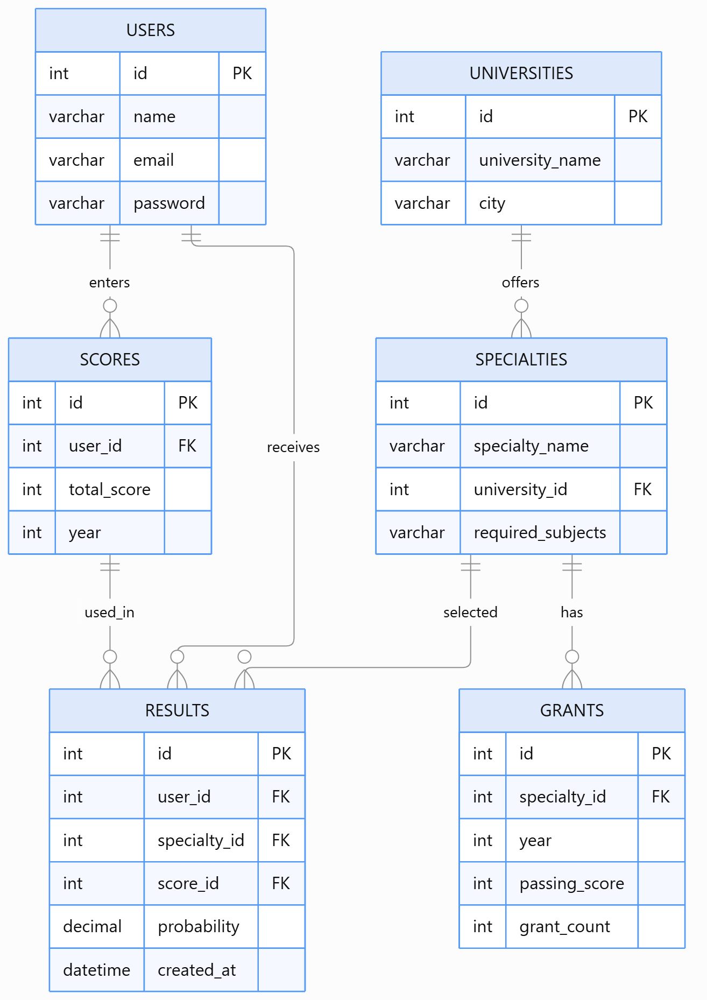

# Грантқа түсу мүмкіндігін есептеу жүйесі (Grant System)

## Жоба туралы

«Грантқа түсу мүмкіндігін есептеу жүйесі» – талапкерлерге ҰБТ нәтижелері бойынша мемлекеттік білім беру грантына түсу мүмкіндігін есептеуге көмектесетін веб-қосымша.

Жүйе талапкердің жинаған балын, таңдаған мамандығын және университетін ескере отырып, грантқа түсу мүмкіндігін алдын ала бағалайды.

Жоба PHP, MySQL, HTML, CSS және JavaScript технологиялары арқылы әзірленеді.

## Жобаның мақсаты

Талапкерлерге ҰБТ нәтижелеріне сәйкес университет пен мамандық таңдауға және мемлекеттік грантқа түсу мүмкіндігін алдын ала анықтауға көмектесетін ыңғайлы веб-жүйе құру.

## Жобаның негізгі міндеттері

- Қолданушыларды тіркеу және жүйеге кіргізу.
- Талапкерлердің жеке кабинетін жасау.
- ҰБТ балдарын енгізу.
- Университеттер тізімін көрсету.
- Білім беру бағдарламалары мен мамандықтарды таңдау.
- Өткен жылдардағы гранттың өту балдарын көрсету.
- Грантқа түсу мүмкіндігін есептеу.
- Есептеу нәтижелерін сақтау.
- Әкімшіге деректерді басқару мүмкіндігін беру.

## Жүйенің негізгі функциялары

1. **Тіркелу** – жаңа қолданушының аккаунт ашуы.
2. **Авторизация** – логин мен құпиясөз арқылы жүйеге кіру.
3. **ҰБТ балдарын енгізу** – талапкердің жинаған балын енгізу.
4. **Университет таңдау** – қажетті жоғары оқу орнын таңдау.
5. **Мамандық таңдау** – білім беру бағдарламасын таңдау.
6. **Мүмкіндікті есептеу** – ҰБТ балын өткен жылдардағы грант өту балдарымен салыстыру.
7. **Нәтижені сақтау** – есептеу тарихын жеке кабинетте сақтау.

## Қолданылатын технологиялар

- HTML – веб-беттің құрылымын жасау.
- CSS – веб-бетті безендіру.
- JavaScript – интерактивті функцияларды орындау.
- PHP – серверлік бөлімді әзірлеу.
- MySQL – деректерді сақтау және басқару.
- GitHub – жобаны сақтау және нұсқаларын басқару.

## Жобаның негізгі беттері

- `index.php` – басты бет.
- `register.php` – тіркелу беті.
- `login.php` – жүйеге кіру беті.
- `profile.php` – жеке кабинет.
- `score.php` – ҰБТ балдарын енгізу.
- `universities.php` – университеттер тізімі.
- `specialties.php` – мамандықтар тізімі.
- `calculate.php` – грант мүмкіндігін есептеу.
- `result.php` – есептеу нәтижесі.
- `admin.php` – әкімші панелі.

## Дерекқор құрылымы

Жобада MySQL дерекқоры қолданылады.

Негізгі кестелер:

| Кесте | Сипаттамасы |
|---|---|
| users | Қолданушылар туралы ақпарат |
| universities | Университеттер туралы ақпарат |
| specialties | Мамандықтар туралы ақпарат |
| scores | Талапкерлердің ҰБТ балдары |
| grants | Грант саны мен өту балдары |
| results | Есептеу нәтижелері |

## Жобаның жұмыс істеу принципі

1. Талапкер жүйеге тіркеледі.
2. Жеке кабинетіне кіреді.
3. ҰБТ жинаған балын енгізеді.
4. Университет пен мамандықты таңдайды.
5. Жүйе енгізілген балды өткен жылдардағы гранттың өту балдарымен салыстырады.
6. Нәтижесінде грантқа түсу мүмкіндігі туралы болжам көрсетіледі.

## Жобаның архитектурасы мен схемасы

Төменде «Грантқа түсу мүмкіндігін есептеу жүйесінің» құрылымы мен жұмыс істеу логикасын көрсететін блок-схема берілген.

